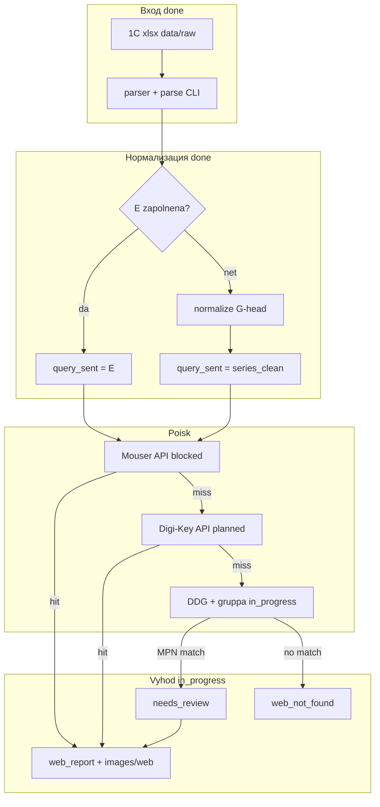
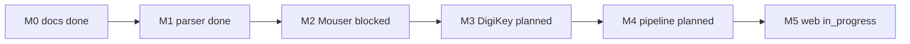

# Блок-схема проекта (источник)

**Смотреть картинку:** двойной щелчок `docs/block-scheme.html` (браузер).

Обновлять при **новых идеях** — **и** этот файл, **и** `block-scheme.html` (одинаковый mermaid).

**Детали** — в `docs/ARCHITECTURE.md`.

## Легенда

| Статус | В подписи узла |

|--------|----------------|

| Идея / позже | `(planned)` |

| В работе | `(in_progress)` |

| Заблокирован | `(blocked)` |

| Готово | `(done)` |

## Поток поиска картинок

## Этапы реализации

## История схемы

| Дата | Что изменили |

|------|----------------|

| 2026-05-26 | Поток поиска картинок, этапы M0–M5 |

| 2026-05-26 | Статусы: M1 done, M2 blocked, M5 in_progress; веб-выход `images/web` |
| 2026-05-26 | M5 v2: trusted listings (Theretroweb/dfi/chipsetpro) поверх v1; сравнение покрытия |

